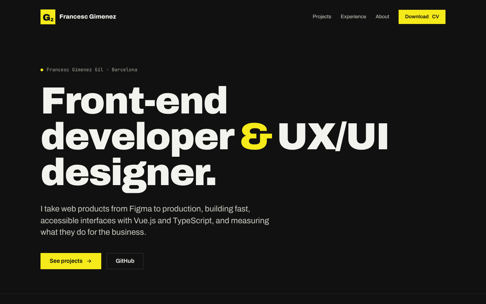

# francescgimenez.com

My personal portfolio: a single page with my projects, experience and contact details.

**Live:** https://franziskus16.github.io/



## Tech

- Vue 3 with `<script setup>` and TypeScript (strict)
- Vite
- Plain CSS with custom properties, self-hosted fonts (Archivo and JetBrains Mono)
- Vitest and Vue Test Utils
- Deployed to GitHub Pages with GitHub Actions on every push to `main`

## How it's organised

All the text lives in [`src/data/content.ts`](src/data/content.ts), typed, so updating the site (a new project, a new job) never means touching the components.

```
src/
├── components/   # SiteHeader, HeroSection, ProjectCard, ProjectsSection, ExperienceSection…
├── data/         # content.ts: profile, projects, experience, skills
├── App.vue
└── style.css     # design tokens and base styles
public/
├── projects/     # project screenshots
└── Francesc_Gimenez_CV.pdf
```

## Running it

```bash
npm install
npm run dev       # http://localhost:5173
npm run test:ci   # tests
npm run build     # type check and production build in dist/
```
